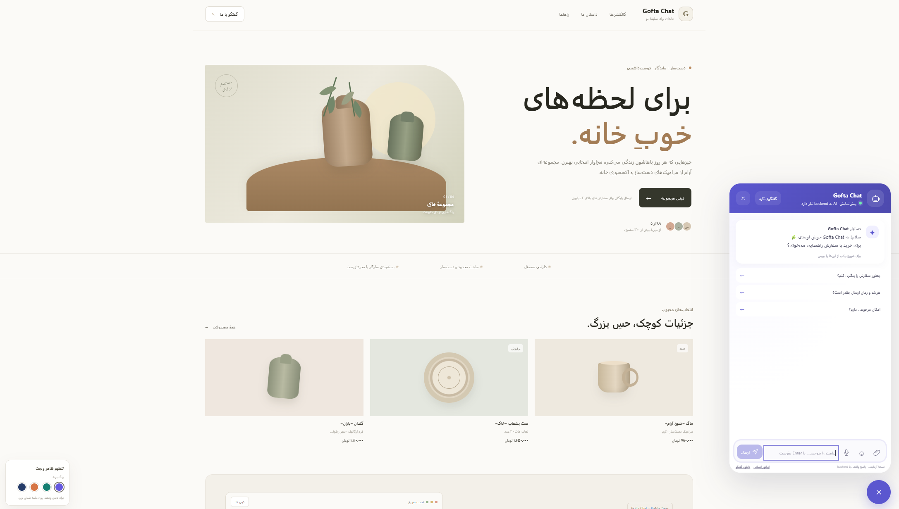
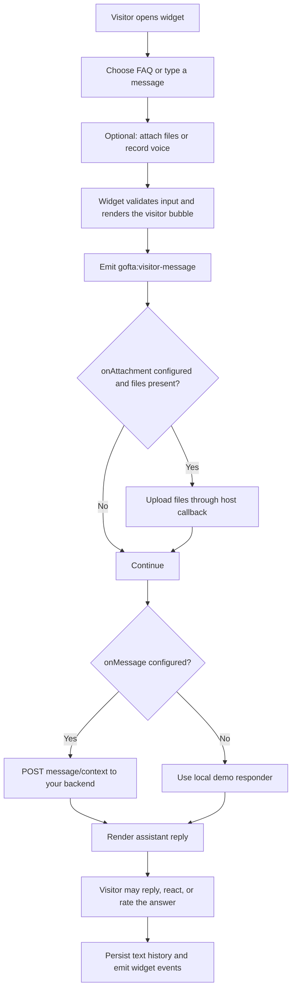

# Gofta Chat Widget

A lightweight, framework-agnostic support chat widget that can be embedded in any website with one JavaScript file. Gofta Chat works with plain HTML, React, Vue, Angular, and other frontend stacks. Its UI and Tailwind CSS styles are bundled into a standalone script and isolated in a Shadow DOM.

> **Scope:** this repository delivers the embeddable frontend widget and a demo storefront. It does not include a production AI service, chat backend, operator dashboard, or file-storage service. Connect the documented callbacks to your own server for production use.

## Preview



The screenshot shows the demo storefront with the Gofta Chat widget open. It is included in the repository so the project README also works offline.

## Contents

- [Quick start](#quick-start)
- [Production installation](#production-installation)
- [Configuration reference](#configuration-reference)
- [Widget API](#widget-api)
- [Conversation flow](#conversation-flow)
- [Backend callbacks](#backend-callbacks)
- [Events](#browser-events)
- [Framework integration](#framework-integration)
- [Privacy and security](#privacy-and-security)
- [Development and tests](#development-and-tests)
- [Troubleshooting](#troubleshooting)

## Quick start

Requirements: Node.js 20+ and npm.

```bash
# From the extracted project directory
npm ci
npm run dev
```

Open `http://localhost:3000` to try the demo storefront and widget. This demo uses sample FAQ responses and local browser previews; it does not contact an AI model or upload files.

Create the production embed bundle with:

```bash
npm run typecheck
npm test
npm run build
```

The standalone output is `dist/gofta-chat-widget.js`. Upload this file to your static host or CDN, then follow the production installation steps below.

## Production installation

1. Build the project with `npm run build` (or use the supplied build artifact).
2. Upload `dist/gofta-chat-widget.js` to a public, HTTPS URL on your site or asset host.
3. Add the configuration before the script tag, then include the script on pages where the chat should appear.

```html
<script>
  window.GoftaChatConfig = {
    siteId: 'store-123',
    brandName: 'My Store',
    assistantName: 'Store Assistant',
    welcomeMessage: 'Hello! How can we help?',
    primaryColor: '#5b57cf',
    direction: 'ltr',
    position: 'right',
    persistHistory: true
  };
</script>
<script src="/assets/gofta-chat-widget.js" defer></script>
```

For an RTL storefront, set `direction: 'rtl'`. The widget is mounted once per page and is independent of your app's CSS because it renders inside a Shadow DOM.

### Minimal HTML-only setup

Most settings can also be passed as script data attributes:

```html
<script
  src="/assets/gofta-chat-widget.js"
  data-site-id="store-123"
  data-brand-name="My Store"
  data-assistant-name="Store Assistant"
  data-primary-color="#5b57cf"
  data-direction="ltr"
  data-position="right"
  defer
></script>
```

When both sources are provided, properties in `window.GoftaChatConfig` override the equivalent data attributes. The script's CSP `nonce`, if present, is also applied to the injected Shadow DOM stylesheet.

## Configuration reference

All options are optional. Defaults are shown below.

| Option | Type | Default | Description |
|---|---|---|---|
| `siteId` | `string` | `gofta-demo` | Site/workspace identifier used in callback context and local storage. Use a distinct value for each installation. |
| `brandName` | `string` | `Gofta Chat` | Brand shown in the widget header. |
| `assistantName` | `string` | Gofta Chat assistant label | Assistant display name. |
| `welcomeMessage` | `string` | Sample welcome greeting | Welcome copy shown when a conversation is empty. Newlines are supported. |
| `primaryColor` | `string` | `#5b57cf` | CSS color for the launcher and visitor bubbles. Invalid CSS colors fall back safely. |
| `direction` | `'rtl' \| 'ltr'` | `'rtl'` | Widget text direction. |
| `position` | `'right' \| 'left'` | `'right'` | Floating launcher position. |
| `initiallyOpen` | `boolean` | `false` | Open the panel immediately after mounting. |
| `persistHistory` | `boolean` | `true` | Store text conversation history in local storage. |
| `maxFileSizeMb` | `number` | `12` | Maximum size per attachment, clamped to 1–50 MB. |
| `maxAttachments` | `number` | `4` | Maximum queued attachments, clamped to 1–8. |
| `maxVoiceSeconds` | `number` | `90` | Maximum voice recording duration, clamped to 5–180 seconds. |
| `faqs` | `FAQItem[]` | Built-in sample FAQs | Optional list of `{ question, answer, keywords? }` used by the demo responder. |
| `styleNonce` | `string` | Script tag nonce | Usually populated automatically from the embedding script's `nonce` attribute. |
| `onMessage` | callback | Demo responder | Send visitor messages to your backend and return the assistant reply. |
| `onAttachment` | callback | None | Upload an attachment to your backend. |
| `onHandoffRequest` | callback | None | Request a live-agent handoff. |
| `onFeedback` | callback | None | Receive a visitor rating (`'up'` or `'down'`) and the rated reply. |

## Widget API

After the script has mounted, control the widget through `window.GoftaChatWidget`:

```js
GoftaChatWidget.open();
GoftaChatWidget.close();
GoftaChatWidget.toggle();
GoftaChatWidget.sendMessage('I need help with an order.');
GoftaChatWidget.identify('customer-42');
GoftaChatWidget.destroy();
```

`identify(visitorId)` associates the current browser conversation with an application-specific visitor ID. `destroy()` removes the widget and its temporary resources. The API is available after the script's `defer` script has executed.

## Conversation flow



Message actions are intentionally tucked into the message's three-dot control. Users can edit or delete only their own messages; assistant messages cannot be deleted. Reactions and feedback are shown on the message they refer to.

A more detailed sequence, including callback failures and handoff, is in [`docs/CONVERSATION_FLOW.md`](docs/CONVERSATION_FLOW.md). Framework-specific snippets are in [`docs/INTEGRATION_GUIDE.md`](docs/INTEGRATION_GUIDE.md).

## Backend callbacks

The widget has no built-in production backend. Keep model/provider secrets on your server and use callbacks to connect your own API.

### Assistant replies

`onMessage(message, context)` may return a string directly or a promise resolving to a string. The context includes `siteId`, `pageUrl`, `pageTitle`, `visitorId`, and—when the visitor replied to a specific message—`replyTo: { id, role, text }`.

```html
<script>
  window.GoftaChatConfig = {
    siteId: 'store-123',
    onMessage: async (message, context) => {
      const response = await fetch('/api/chat', {
        method: 'POST',
        headers: { 'Content-Type': 'application/json' },
        body: JSON.stringify({ message, context })
      });
      if (!response.ok) throw new Error('Chat service unavailable');
      const data = await response.json();
      return data.reply;
    }
  };
</script>
```

### Attachments and handoff

```js
window.GoftaChatConfig = {
  onAttachment: async (file, context) => {
    const body = new FormData();
    body.append('file', file);
    body.append('siteId', context.siteId);
    body.append('visitorId', context.visitorId);
    const response = await fetch('/api/chat/attachments', { method: 'POST', body });
    if (!response.ok) throw new Error('Upload failed');
  },
  onHandoffRequest: async (context) => {
    const response = await fetch('/api/chat/handoff', {
      method: 'POST',
      headers: { 'Content-Type': 'application/json' },
      body: JSON.stringify({ siteId: context.siteId, visitorId: context.visitorId })
    });
    if (!response.ok) throw new Error('Handoff failed');
  },
  onFeedback: (rating, replyText) => {
    // Send the rating to your analytics/support API if desired.
    console.info('Assistant rating:', rating, replyText);
  }
};
```

Callbacks run in the visitor's browser. Validate permissions, file type/size, rate limits, and identity again on the server; do not trust browser-supplied `siteId` or `visitorId` as authorization.

## Browser events

The widget dispatches `CustomEvent`s on `window`. Each event uses the `gofta:` prefix and includes `detail.siteId`.

| Event | Additional detail |
|---|---|
| `gofta:open`, `gofta:close` | Panel visibility changed. |
| `gofta:visitor-message` | `messageId`, `text`, optional `replyTo`, and attachment metadata. |
| `gofta:assistant-message` | `messageId`, `text`. |
| `gofta:message-edited`, `gofta:message-deleted`, `gofta:message-restored` | `messageId`; edit also includes `text`. |
| `gofta:message-reaction` | `messageId`, selected `reaction` or `null`. |
| `gofta:attachment-selected` | `count`, file `names`. |
| `gofta:attachments-uploaded` | `messageId`, uploaded `count`. |
| `gofta:voice-recorded` | `durationSeconds`, `size`. |
| `gofta:handoff-request` | `visitorId`. |
| `gofta:feedback` | `messageId`, `rating`. |
| `gofta:identify` | `visitorId`. |

Example listener:

```js
window.addEventListener('gofta:visitor-message', (event) => {
  console.log(event.detail.siteId, event.detail.text);
});
```

## Framework integration

The bundle is a classic browser script, so it can be loaded from any framework without installing a runtime package. For React, Vue, and Next.js examples—including cleanup and SSR notes—see [`docs/INTEGRATION_GUIDE.md`](docs/INTEGRATION_GUIDE.md).

## Privacy and security

- Text history and the visitor ID are stored in `localStorage` when `persistHistory` is enabled. Set it to `false` to disable conversation history persistence.
- Binary media is not stored in local storage. Attachment previews use temporary object URLs that are revoked when removed or when the widget is destroyed.
- Files and voice recordings are only uploaded when you configure `onAttachment`; otherwise they remain local previews.
- Microphone capture requires explicit browser permission and a secure context (HTTPS, or localhost during development).
- Use HTTPS, server-side authorization, validation, abuse controls, and consent disclosures appropriate to your application.
- Shadow DOM isolates widget styles from the host page; it is not an authorization or security boundary.

## Development and tests

```bash
npm ci
npm run dev          # Demo at http://localhost:3000
npm run typecheck    # TypeScript validation
npm test             # Unit tests
npm run build        # dist/gofta-chat-widget.js
npm audit            # Dependency audit
```

The production bundle includes its CSS and has no runtime framework dependency. Tailwind CSS 4 and Vite are build-time dependencies.

### Project structure

```text
src/
  embed.ts              Classic-script bootstrap and config parsing
  widget.ts             Widget UI, API, state, events, and callbacks
  widget.css            Tailwind-based styles injected into Shadow DOM
  replies.ts            Demo FAQ data and local sample responder
  replies.test.ts       Demo responder tests
  demo.ts               Demo storefront and live widget setup
  demo.css              Demo storefront styles
docs/
  CONVERSATION_FLOW.md  Message, attachment, feedback, and handoff flows
  INTEGRATION_GUIDE.md  Plain HTML, React, Next.js, and Vue setup examples
dist/
  gofta-chat-widget.js  Standalone production embed bundle
```
