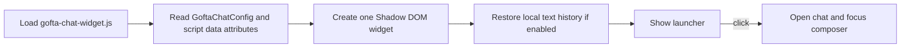
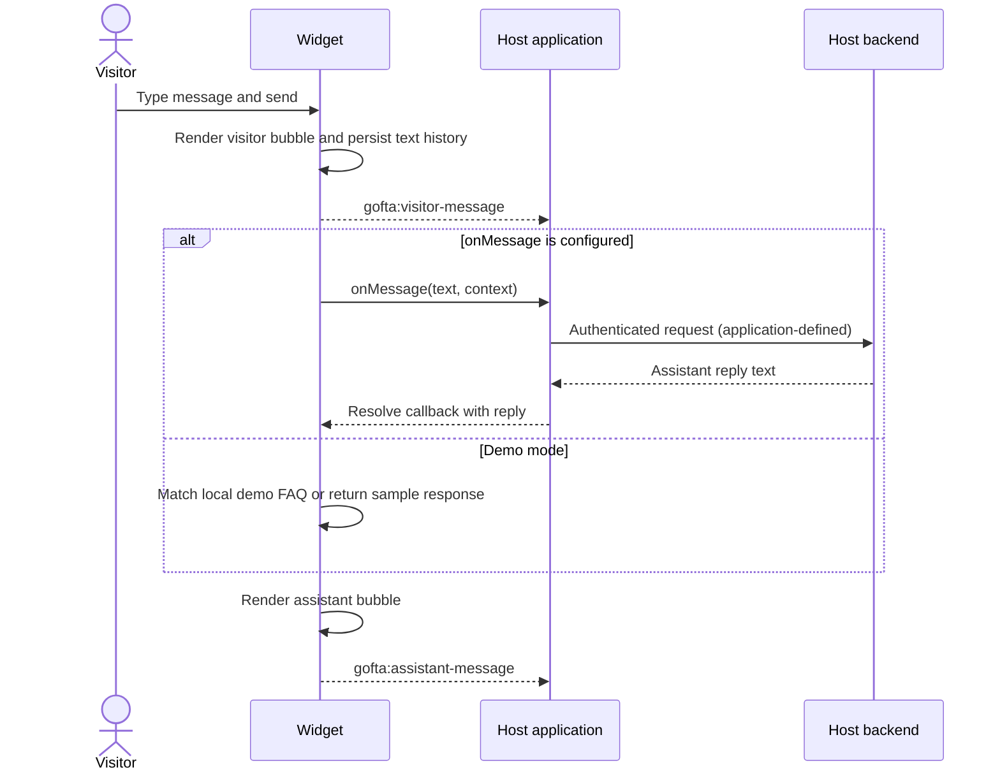
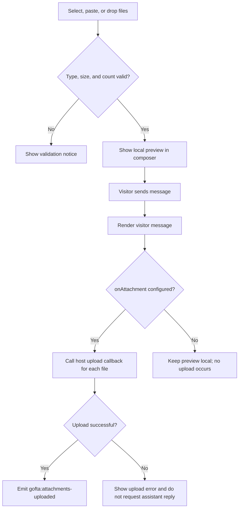

# Conversation and Interaction Flow

This document describes what the browser widget does and where the host application's backend fits in.

## 1. Mount and initialize

The script is a singleton per page. Configuration on `window.GoftaChatConfig` takes precedence over supported `data-*` attributes. Calling `destroy()` removes the widget and its temporary object URLs.

## 2. Text message and assistant reply

### Replying to a specific message

1. Open the message's three-dot actions.
2. Choose **Reply**.
3. Confirm the quoted target shown above the composer, then send.
4. The visitor bubble contains a clickable quote; `onMessage` receives `context.replyTo` with the target message's `id`, `role`, and `text`.

## 3. Message actions and feedback

Actions stay out of the conversation until the three-dot control is activated. The available actions depend on message ownership:

| Message | Available actions |
|---|---|
| Visitor's own message | Reply, copy, edit, delete with undo, and emoji reaction |
| Assistant message | Reply, copy, emoji reaction, and helpful/not-helpful feedback |

The widget does not offer edit or delete controls for assistant messages. After a visitor selects an emoji reaction or rates an assistant reply, the selected mark is rendered on the related message. A visitor can click their reaction mark to remove it. Feedback is sent to the optional `onFeedback` callback and `gofta:feedback` event.

Deleting one of the visitor's messages removes it immediately and shows an undo control for seven seconds. The widget emits `gofta:message-deleted`; if restored, it emits `gofta:message-restored`.

## 4. Attachments and voice

Voice recording uses the browser `MediaRecorder` API. After recording, the visitor can preview the audio before sending. Microphone access requires permission and a secure origin (HTTPS or localhost). Without `onAttachment`, files and recordings are not sent to a server.

## 5. Handoff and failure behavior

- Selecting **Human agent** calls `onHandoffRequest(context)` when provided and emits `gofta:handoff-request`.
- If `onMessage` rejects, the widget renders a recoverable assistant error message and logs a diagnostic to the browser console.
- If `onAttachment` rejects, the visitor sees an upload notice and the assistant callback is skipped for that send.
- Starting a new conversation uses a two-step confirmation. Clearing also invalidates pending assistant responses so a late response does not repopulate the cleared thread.

## 6. Persistence model

When `persistHistory` is enabled, text messages, timestamps, reply references, edits, reactions, and feedback are stored in local storage, scoped by `siteId`. Binary file data is not stored. Conversation history stored by the previous widget version is migrated on first load when a matching legacy key is present. Set `persistHistory: false` to disable history persistence.
